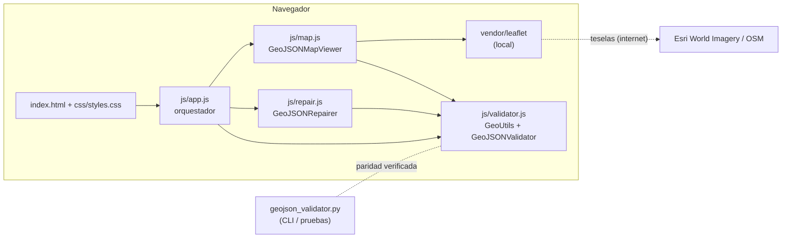

# ARQUITECTURA — Revisor GeoJSON

**Autor:** Renato Andara · **Versión:** 2.0.0

## 1. Visión general

Aplicación web 100 % cliente (sin servidor de aplicación): el archivo se lee con `FileReader`, se valida en el navegador y nunca se transmite. Un motor Python equivalente permite el uso por línea de comandos y la automatización.



## 2. Estructura

```
revisor_geojson/
├── index.html              Interfaz
├── css/styles.css          Estilos (tema oscuro, adaptable a móvil)
├── js/
│   ├── validator.js        FUENTE ÚNICA del motor: GeoUtils, GeoJSONValidator
│   ├── repair.js           Reparador y descargas
│   ├── map.js              Visor Leaflet + respaldo SVG
│   └── app.js              Orquestación de la interfaz
├── vendor/leaflet/         Leaflet 1.9.4 (BSD-2-Clause) incluido localmente
├── geojson_validator.py    Motor Python equivalente + CLI
├── serve.py                Servidor local (127.0.0.1)
└── tests/
    ├── fixtures/           Archivos de ejemplo + expected.json (compartidos JS/Python)
    ├── test_validator.test.js
    └── test_validator.py   Incluye prueba de paridad JS ↔ Python
```

**Decisión clave — una sola fuente del motor JS.** Cada archivo de `js/` es un *script clásico* con envoltorio UMD: en el navegador publica sus clases en `window`, y en Node se carga con `require()`. Así funciona con doble clic (`file://`, donde los módulos ES están bloqueados por CORS) y las pruebas ejercitan exactamente el código que corre en el navegador. La versión 1 tenía el motor copiado dos veces (`app.js` y los módulos ES), y las pruebas validaban una copia distinta de la que se ejecutaba.

Orden de carga: `leaflet.js` → `validator.js` → `repair.js` → `map.js` → `app.js`.

## 3. Motor de validación (`js/validator.js`)

### 3.1 Flujo

1. **Entrada:** quita BOM UTF-8, detecta archivo vacío, `JSON.parse`.
2. **Raíz:** FeatureCollection / Feature / geometría suelta; aviso por `crs`.
3. **Por entidad:** estructura del Feature, geometría (incluye GeometryCollection recursiva), precisión de coordenadas.
4. **Por posición:** numérica, rango WGS84 (agregado por anillo, con pista UTM / lat-lon invertidas).
5. **Por anillo:** ≥ 4 posiciones, cerrado, duplicados consecutivos, degenerado, auto-intersecciones, orientación.
6. **Por polígono:** huecos (cruces con otros anillos, contención, huecos anidados).
7. **Global:** identificadores duplicados, solapamientos entre polígonos y entre partes de un MultiPolygon.
8. **Resultado:** `{ valid, overall_status, status_text, features_count, summary, features[], issues[], data }`. `features[]` trae el estado, área, perímetro y vértices de cada entidad (para colorear el mapa y la pestaña *Entidades*).

### 3.2 Geometría robusta

- **`segmentRelation(p1,p2,q1,q2)`** clasifica cada par de segmentos en *cruce propio*, *contacto en un punto* o *superposición colineal*, con tolerancia relativa (1e-10) para el ruido de coma flotante. La v1 solo detectaba cruces propios y reportaba los puntos de contacto varias veces.
- **Barrido por X (`sweepPairs`)**: los segmentos se ordenan por su X mínima y solo se comparan los que solapan en caja. Un anillo de 20 000 vértices se valida en ~0,1 s (antes O(n²) puro).
- **Solapamiento entre parcelas** = intersección de **interiores**: hay solapamiento si existe un cruce propio entre bordes, o si algún vértice/punto medio de un polígono cae estrictamente dentro del otro (considerando huecos); si todos caen sobre el borde, las geometrías son idénticas. Así, compartir linderos o vértices no es solapamiento, y una parcela dentro del hueco de otra tampoco.
- **Límite de diagnósticos:** máximo 25 por anillo + un resumen, para que un anillo desordenado no genere miles de filas.

### 3.3 Métricas

- Área esférica por la fórmula de Chamberlain-Duquette sobre R = 6 378 137 m; área neta = exterior − huecos.
- Perímetro por Haversine (R medio = 6 371 008,8 m).
- Son aproximaciones adecuadas para revisión; el valor oficial debe calcularse en un SIG con el elipsoide.

## 4. Reparador (`js/repair.js`)

Solo aplica correcciones que no cambian la forma: cerrar anillos (sin perder el último vértice, error de la v1), quitar duplicados consecutivos (incluido el previo al cierre), orientar anillos, añadir `properties`, quitar `crs` WGS84. Devuelve `{ repairedData, changes, unrepaired }`; la interfaz vuelve a validar el resultado e informa los errores que quedan. El bloque `metadata` es opcional (desactivado por defecto).

## 5. Visor (`js/map.js`)

- Leaflet local con `preferCanvas`; capa por entidad con color según su estado.
- Marcadores de problemas (errores y alertas) y segmentos en conflicto, como capas activables.
- Flechas de dirección con corrección de ángulo por latitud (Mercator) y números de vértice; se omiten por encima de 3000 vértices.
- Respaldo SVG si Leaflet no está disponible: dibuja todas las parcelas (con huecos, `fill-rule="evenodd"`) y los puntos de problema.

## 6. Seguridad y privacidad

- **Zero-upload:** ningún dato sale del navegador (salvo las peticiones de teselas del mapa base, que solo revelan la zona visualizada).
- **Escapado de HTML:** todo texto procedente del archivo (identificadores, propiedades, mensajes) pasa por `GeoUtils.escapeHtml` antes de insertarse en tablas o ventanas emergentes. La v1 insertaba `PlotID` y propiedades sin escapar (inyección de HTML/JS con un archivo malicioso).
- **Servidor local** ligado a `127.0.0.1` (la v1 escuchaba en todas las interfaces, exponiendo la carpeta a la red local) y sin cabecera CORS abierta.
- **Sin dependencias externas en tiempo de ejecución** salvo las teselas; Leaflet se distribuye en `vendor/` (hash SHA-256 idéntico al SRI oficial de la versión 1.9.4).

## 7. Pruebas

- `npm test` → 27 pruebas del motor JS con `node:test`.
- `python -m unittest discover -s tests` → pruebas Python, incluida la **paridad**: ejecuta el motor JS sobre los mismos archivos y exige diagnósticos idénticos (severidad, categoría y mensaje).
