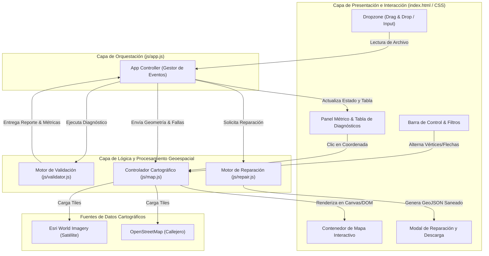
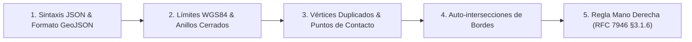
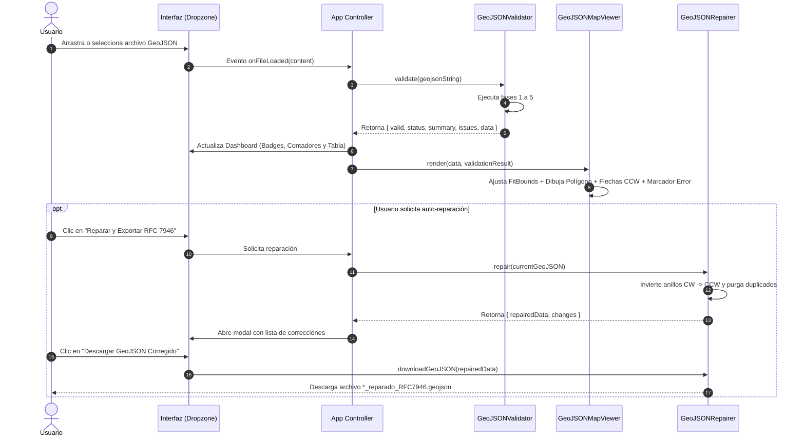

# ARQUITECTURA DEL SISTEMA

## Arquitectura de Software: Validador y Visualizador Cartográfico GeoJSON

---

### 1. Visión General de la Arquitectura

El sistema está diseñado bajo una **arquitectura modular desacoplada basada en la web (Client-Side First)**, garantizando que el procesamiento y diagnóstico de las geometrías ocurra directamente en el entorno local del usuario sin transmitir datos sensibles a servidores externos.

La solución combina un núcleo matemático de validación topológica y geométrica con una capa de visualización cartográfica en tiempo real sobre imágenes satelitales de alta resolución.



---

### 2. Estructura de Componentes y Capas

La solución se organiza en 5 capas claramente delimitadas:

```
Revisor archivos GeoJSON/
├── index.html                  # Capa de Presentación (Estructura DOM)
├── css/
│   └── styles.css              # Capa de Estilos (Diseño responsivo Dark GIS)
├── js/
│   ├── app.js                  # Capa de Orquestación y Coordinación
│   ├── validator.js            # Capa de Lógica: Motor de Validación
│   ├── repair.js               # Capa de Lógica: Motor de Reparación y Exportación
│   └── map.js                  # Capa de Visualización: Controlador de Mapa Leaflet
├── geojson_validator.py        # Motor de validación en Python (Línea de comandos / Pruebas)
├── serve.py                    # Capa de Servidor Local y Lanzador
└── tests/
    ├── test_validator.py       # Pruebas automatizadas en Python
    └── test_js_validator.js    # Pruebas automatizadas en JavaScript
```

---

### 3. Descripción Detallada de los Módulos

#### 3.1. Módulo Orquestador (`js/app.js`)
Actúa como controlador central (*Controller*):
- Captura eventos de arrastrar y soltar (*drag & drop*) y selección de archivos locales mediante la API nativa `FileReader`.
- Se vincula al elemento nativo `<label for="file-input">` asegurando la apertura inmediata de la ventana de selección de archivos en cualquier navegador sin depender de eventos sintéticos.
- Resetea dinámicamente el valor del input para permitir cargas y re-evaluaciones continuas del mismo archivo o de archivos distintos.
- Coordina el flujo de datos entre el analizador de archivos, el motor de validación, la tabla de resultados y el mapa cartográfico.
- Aplica filtros dinámicos sobre la tabla de diagnósticos (Todos, Errores ❌, Alertas ⚠️, Información ℹ️).
- Vincula eventos de clic en las coordenadas del reporte para realizar encuadres (*pan & zoom*) automáticos sobre el mapa.
- Empaquetado como script universal autocontenido: elimina el bloqueo CORS de módulos ES al ejecutarse directamente mediante el protocolo local `file:///` y mantiene compatibilidad total con servidores HTTP (`http://localhost:8000`).

#### 3.2. Motor de Validación Geoespacial (`js/validator.js`)
Implementa una canalización de validación en 5 etapas independientes:



1. **Etapa 1 (Sintaxis y Estructura):** Valida tipos GeoJSON oficiales (`FeatureCollection`, `Feature`, `Polygon`, `MultiPolygon`).
2. **Etapa 2 (Límites y Cierre):** Verifica que las coordenadas se ubiquen en el rango WGS84 (Longitud $[-180, 180]$, Latitud $[-90, 90]$), que cada anillo lineal contenga al menos 4 puntos y que el primer punto sea exactamente idéntico al último.
3. **Etapa 3 (Vértices Duplicados):** Detecta vértices consecutivos redundantes y puntos de contacto no adyacentes (*pinch points*).
4. **Etapa 4 (Auto-intersecciones):** Ejecuta la prueba de producto cruzado para localizar cruces de segmentos de recta no contiguos y calcula el punto exacto de la colisión.
5. **Etapa 5 (Regla de la Mano Derecha):** Calcula el área con signo mediante la fórmula de Shoelace. Si el anillo exterior es horario (CW) o los anillos interiores son antihorarios (CCW), genera una **ALERTA** no bloqueante citando el RFC 7946 y los requisitos de EUDR/TRACES.

#### 3.3. Controlador Cartográfico (`js/map.js`)
Gestiona la renderización en el mapa interactivo mediante **Leaflet**:
- **Ajuste Dinámico de Encuadre (`FitBounds`):** Calcula la caja envolvente de las geometrías y posiciona la cámara con margen ergonómico.
- **Alternancia de Capas Base:** Permite seleccionar entre imágenes satelitales mundiales de alta resolución (**Esri World Imagery**) y mapas de vialidad y toponimia (**OpenStreetMap**).
- **Estilos Semánticos:** Asigna colores a los polígonos según su estado de salud geométrica:
  - 🟢 **Verde (`#10b981`):** Polígono completamente válido.
  - 🟡 **Ámbar (`#f59e0b`):** Polígono con advertencias RFC 7946.
  - 🔴 **Rojo (`#ef4444`):** Polígono con errores topológicos críticos.
- **Marcador Pulsante de Solapamiento:** Sitúa un indicador visual pulsante sobre la coordenada exacta del cruce.
- **Resaltado de Segmentos Cruzados:** Traza una línea discontinua de alta visibilidad sobre los segmentos que se intersectan.
- **Indicadores Direccionales SVG:** Dibuja flechas orientadas a lo largo de los bordes del polígono que muestran visualmente si el giro es antihorario (CCW) u horario (CW).
- **Numeración Secuencial de Vértices:** Permite activar o desactivar marcadores circulares del 1 al $N$ en cada vértice perimetral.
- **Modo de Respaldo Vectorial Nativo:** Incorpora un visor SVG autónomo que garantiza la visualización de la geometría en caso de desconexión absoluta a internet.

#### 3.4. Motor de Auto-Reparación y Exportador (`js/repair.js`)
Proporciona utilidades de corrección no destructiva:
- Invierte el orden del arreglo de coordenadas cuando un anillo exterior es horario o un hueco es antihorario, haciéndolo 100% compatible con RFC 7946.
- Elimina vértices consecutivos duplicados manteniendo los linderos intactos.
- Añade metadatos de trazabilidad (`metadata.repaired_by`, fecha y lista de cambios).
- Genera un archivo `.geojson` descargable mediante la creación dinámica de un objeto `Blob` y un enlace virtual `URL.createObjectURL`.

#### 3.5. Servidor Local y Lanzador (`serve.py`)
Script en Python 3 que provee:
- Servidor HTTP ligero basado en `http.server.SimpleHTTPRequestHandler`.
- Inyección de cabeceras CORS y políticas de deshabilitación de caché (`no-cache, no-store`).
- Mecanismo de búsqueda automática de puertos libres (de 8000 a 8010).
- Apertura automática del navegador del sistema operativo con el módulo `webbrowser`.

---

### 4. Diagrama de Secuencia del Flujo de Datos



---

### 5. Consideraciones de Seguridad y Privacidad

- **Privacidad Total de Datos (Zero-Upload):** La totalidad del análisis, cálculo de áreas, detección de cruces y reparación ocurre localmente en el motor de JavaScript del navegador del usuario. No se envía ningún dato predial o confidencial a servidores remotos.
- **Aislamiento y Sanitización:** Los textos e identificadores de parcelas son renderizados mediante propiedades seguras del DOM evitando inyecciones de código.
- **Independencia de Dependencias:** El núcleo no depende de frameworks pesados (React, Angular) ni de compiladores (Webpack, Vite), facilitando una ejecución inmediata y sin mantenimiento de infraestructura.
